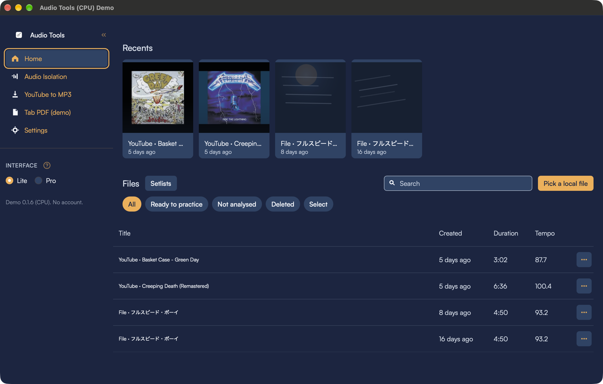
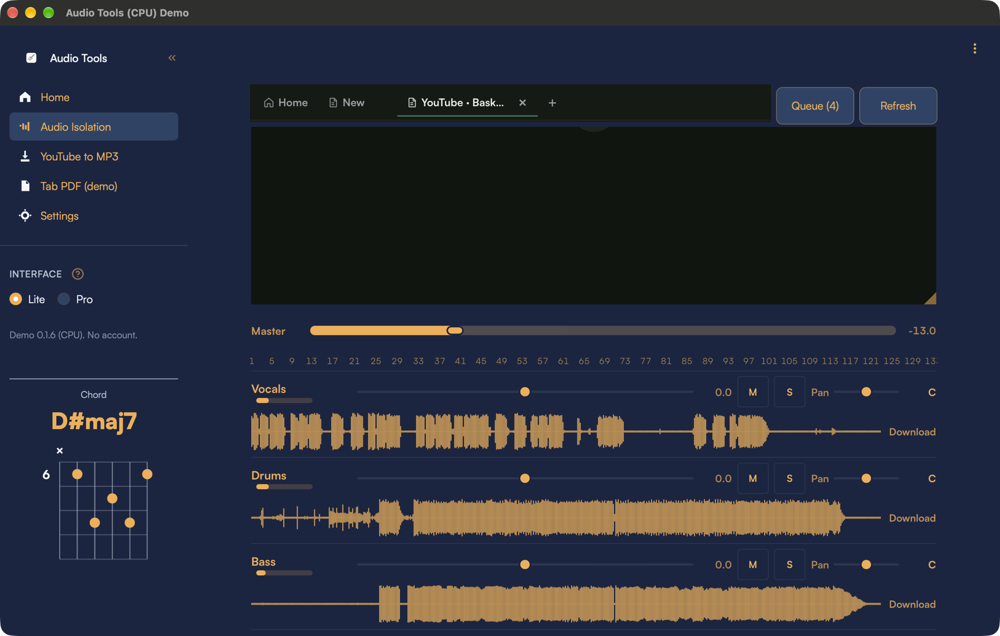
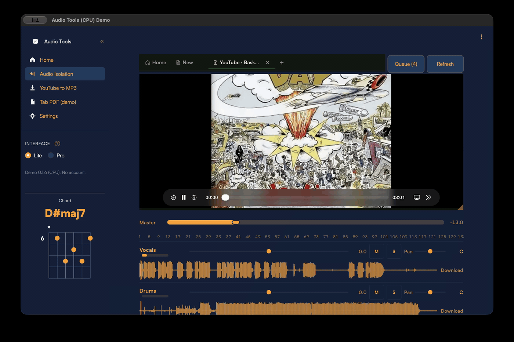

<p align="center">
  
</p>

<h1 align="center">Audio Tools</h1>

<p align="center">
  Separate a song into stems, practice with a mixer and chord chart, and export a guitar tab PDF.<br>
  One shared engine powers a local desktop app and a hosted website.
</p>

<p align="center">
  <a href="https://github.com/notjj1234/audiotools/actions/workflows/ci.yml"></a>
  
  
  
</p>

<p align="center">
  <a href="DESKTOP.md">Desktop install</a> ·
  <a href="DEPLOY.md">Hosted deploy</a> ·
  <a href="#quickstart">Quickstart</a> ·
  <a href="CONTRIBUTING.md">Contributing</a>
</p>

<p align="center">
  
</p>

*Desktop Home — Learn a song, YouTube, Tab PDF, Recents, and the file library (full window).*

<p align="center">
  
</p>

*Audio Isolation — stem mixer with waveforms, mute/solo/level/pan, while listening to Waltz for Debby.*

<p align="center">
  
</p>

*Same mixer while playback runs (GIF). MP4 copy: [docs/screenshots/desktop-mixer.mp4](docs/screenshots/desktop-mixer.mp4).*

## About

- **Desktop** runs on this computer: Streamlit in `ui/`, started by `packaging/launcher.py`. No Docker.
- **Website** is the hosted app: FastAPI in `backend/` plus the React app in `web/`.
- **Shared engine** lives in `src/audio_to_tab/` (import as `audio_to_tab`).

Python **3.11** (3.10–3.12 only). Desktop installers and the tester app: [DESKTOP.md](DESKTOP.md). Hosted deploy: [DEPLOY.md](DEPLOY.md).

## Table of contents

- [Quickstart](#quickstart)
- [Tester](#tester)
- [Build installers (0.1.6)](#build-installers-016)
- [Contributing](#contributing)

## Quickstart

From a clone:

```bash
make install
make test
```

On Windows:

```powershell
.\scripts\dev.ps1 install
.\scripts\dev.ps1 test
```

---

## Tester

**Windows CPU**
```powershell
$env:AUDIO_TOOLS_EDITION = "cpu"
.\.venv311\Scripts\python.exe packaging/launcher.py
```

**Windows GPU**
```powershell
$env:AUDIO_TOOLS_EDITION = "cuda"
.\.venv-desktop\Scripts\python.exe packaging/launcher.py
```

**macOS (Apple Silicon / Intel)**
```bash
python3.11 -m venv .venv-desktop
source .venv-desktop/bin/activate
python -m pip install --upgrade pip
pip install -e ".[demucs,desktop,roformer,separator]"

.venv-desktop/bin/python packaging/launcher.py
```

---

## Build installers (0.1.6)

### Windows CPU

```powershell
py -3.11 -m venv .venv-desktop-cpu          
.\.venv-desktop-cpu\Scripts\Activate.ps1
python -m pip install --upgrade pip
python -m pip install --upgrade "torch>=2.2,<2.14" "torchaudio>=2.2,<2.12"
pip install -e ".[demucs,desktop,roformer,separator]"
.\scripts\dev.ps1 mixer-build                  
python packaging/bundle_ffmpeg.py
$env:AUDIO_TOOLS_EDITION = "cpu"
pyinstaller packaging/audio_tools.spec --noconfirm --clean
powershell -ExecutionPolicy Bypass -File packaging/make_windows_installer.ps1 -Flavor cpu -CopyToDownloads
```
→ `%USERPROFILE%\Downloads\AudioTools-0.1.6-windows-x64-cpu-setup.exe`

### Windows combined (CPU + NVIDIA GPU)

```powershell
py -3.11 -m venv .venv-desktop               
.\.venv-desktop\Scripts\Activate.ps1
python -m pip install --upgrade pip
python -m pip install --upgrade "torch>=2.2,<2.14" "torchaudio>=2.2,<2.12" --index-url https://download.pytorch.org/whl/cu126
pip install "bs-roformer-infer>=0.1.5"
pip install -e ".[demucs,desktop,separator]"
.\scripts\dev.ps1 mixer-build                  
python packaging/bundle_ffmpeg.py
$env:AUDIO_TOOLS_EDITION = "both"
pyinstaller packaging/audio_tools.spec --noconfirm --clean
powershell -ExecutionPolicy Bypass -File packaging/make_windows_installer.ps1 -Flavor both -CopyToDownloads
```
→ `%USERPROFILE%\Downloads\AudioTools-0.1.6-windows-x64-both-setup.exe`

### Windows GPU (CUDA) only

```powershell
.\.venv-desktop\Scripts\Activate.ps1
python packaging/bundle_ffmpeg.py
$env:AUDIO_TOOLS_EDITION = "cuda"
pyinstaller packaging/audio_tools.spec --noconfirm --clean
powershell -ExecutionPolicy Bypass -File packaging/make_windows_installer.ps1 -Flavor cuda -CopyToDownloads
```
→ `%USERPROFILE%\Downloads\AudioTools-0.1.6-windows-x64-cuda-setup.exe`

### macOS Apple Silicon (M1–M4)

```bash
cd <repo>

python3.11 -m venv .venv-desktop
source .venv-desktop/bin/activate
python -m pip install --upgrade pip
python -m pip install --upgrade "torch>=2.2,<2.14" "torchaudio>=2.2,<2.12"
pip install -e ".[demucs,desktop,roformer,separator]"

make mixer-build
make desktop-bundle-ffmpeg
make desktop-build
make desktop-pkg
```

→ `~/Downloads/AudioTools-0.1.6-macos-arm64-silicon.pkg`


### macOS Intel (x64)

**On an Intel Mac:** same steps as Apple Silicon above.

**On an Apple Silicon Mac** (Rosetta x86_64 freeze):

```bash

arch -x86_64 python3.11 -m venv .venv-desktop-x64
source .venv-desktop-x64/bin/activate
python -m pip install --upgrade pip
python -m pip install --upgrade "torch>=2.2,<2.14" "torchaudio>=2.2,<2.12"
pip install -e ".[demucs,desktop,roformer,separator]"

make mixer-build
.venv-desktop-x64/bin/python packaging/bundle_ffmpeg.py
.venv-desktop-x64/bin/python -m PyInstaller packaging/audio_tools.spec --noconfirm --clean
./packaging/make_pkg.sh
```

→ `~/Downloads/AudioTools-0.1.6-macos-x64-intel.pkg`

---

## Contributing

PRs welcome. Start with [CONTRIBUTING.md](CONTRIBUTING.md).

- [Good first issues](https://github.com/notjj1234/jj_audio_website/issues?q=is%3Aissue+is%3Aopen+label%3A%22good+first+issue%22)
- [Help wanted](https://github.com/notjj1234/jj_audio_website/issues?q=is%3Aissue+is%3Aopen+label%3A%22help+wanted%22)
